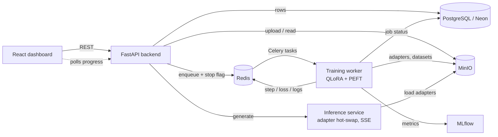

<p align="center">
  <a>
    
  </a>
</p>

<p align="center">
  <a href="#run-it"></a>
  <a href="#run-it"></a>
  <a href="#architecture"></a>
  <a href="#run-it"></a>
  <a href="#hardware-notes"></a>
</p>


> **⚠️ Honest framing.** Cube is a single-user, self-hosted fine-tuning workbench, not a managed platform. There is no login, no multi-tenancy and no autoscaling. Real QLoRA training needs an NVIDIA GPU; on CPU it only exercises the pipeline. The training-time estimate is a heuristic, not a measurement.


## Table of contents

1. [Run it](#run-it)
2. [Using Cube](#using-cube)
3. [Training config](#training-config)
4. [Services](#services)
5. [Hardware notes](#hardware-notes)
6. [Architecture](#architecture)
7. [Design decisions](#design-decisions)
8. [Project layout](#project-layout)
9. [Testing](#testing)
10. [Local development](#local-development)
11. [Extending](#extending)
12. [Troubleshooting](#troubleshooting)
13. [Known limitations](#known-limitations)
14. [Credits](#credits)


## Run it

You need **Docker + Docker Compose**, and a free [NeonDB](https://neon.tech) Postgres database (a local Postgres also works).

```bash
# 1. configure
cp .env.example .env
#    set DATABASE_URL (see database/NEONDB_GUIDE.md)

# 2. create the tables: Neon SQL Editor -> paste database/neondb_setup.sql -> Run

# 3a. CPU (exercises the whole pipeline, produces a useless model)
docker compose up --build

# 3b. ...or with an NVIDIA GPU (real QLoRA fine-tuning)
docker compose -f docker-compose.yml -f docker-compose.gpu.yml up --build
```

Open **http://localhost:3000**.

| Setup | Result |
| --- | --- |
| NVIDIA GPU, Ampere or newer, 16 GB+ | 4-bit QLoRA, Flash Attention 2, bf16: the real thing |
| Any GPU without Flash Attention 2 | Falls back to PyTorch SDPA automatically |
| CPU only | CUDA-only options are disabled (and logged), slow fp32 run |
| No `DATABASE_URL` | Backend cannot start |


## Using Cube

<!-- Add screenshots/GIF here, e.g.
### 1. Upload

### 2. Live training

-->

The sidebar follows the pipeline order:

| Step | Page | What happens |
| --- | --- | --- |
| 1 | **Upload** | PDF, TXT, JSONL (`{"text": ...}` or `{"instruction", "response"}`) and code files go to MinIO |
| 2 | **Dataset** | Clean, deduplicate, train/val split, write JSONL. Tokenisation is deferred and cached per base model |
| 3 | **Model** | Pick a Hugging Face base model and the QLoRA / speed options |
| 4 | **Training** | Pre-flight time estimate, live loss and LR charts, streaming logs, stop on demand |
| 5 | **Evaluation** | Perplexity on the held-out set using the real fine-tuned adapter |
| 6 | **Deploy** | API key, REST endpoint and a streaming (SSE) chat playground |

**Things to try**

- Upload a small `.jsonl`, process it, and train **TinyLlama 1.1B** for one epoch
- Press **Stop** mid-run: the job ends gracefully and the status updates
- Open **MLflow** (`:5000`) to compare runs, **Flower** (`:5555`) to watch the queue
- Hit **Deploy**, copy the `curl` example and call your model from a terminal

Supported base models out of the box: Llama 3.2 (1B, 3B), Llama 3.1 8B, Mistral 7B, Qwen2.5 (1.5B, 7B), Gemma 2 2B, Phi-3.5 mini, TinyLlama 1.1B.


## Training config

`TrainingConfig` (`backend/app/schemas/training.py`) is the one contract shared by the UI form, API validation and the Trainer.

| Option | Default | Why |
| --- | --- | --- |
| `load_in_4bit` | on | NF4 base weights: a 7-8B model's frozen weights fit in a fraction of the VRAM |
| `use_lora` | on | Train ~0.1-2% of parameters; adapters are MBs, not GBs |
| `lora_r` / `lora_alpha` / `lora_dropout` | 16 / 32 / 0.05 | Standard QLoRA starting point |
| `use_flash_attention_2` | on | Falls back to SDPA if unsupported |
| `mixed_precision` | bf16 | |
| `optimizer` | `paged_adamw_8bit` | Keeps optimizer state small |
| `use_gradient_checkpointing` | on | ~20% slower, big VRAM savings |
| `pack_sequences` | on | Concatenate short examples instead of padding |
| `use_torch_compile` | on | ~30-60 s warm-up |
| `use_unsloth` | off | Experimental, needs `use_lora` |

Invalid combinations (for example 4-bit without LoRA) are rejected with `422` before anything is queued.


## Services

| Service | URL | Purpose |
| --- | --- | --- |
| Frontend | http://localhost:3000 | Main app |
| Backend API | http://localhost:8000 | REST API |
| API docs | http://localhost:8000/docs | Swagger |
| Inference | http://localhost:8001 | Adapter-aware model serving |
| MLflow | http://localhost:5000 | Experiment tracking |
| Flower | http://localhost:5555 | Celery job monitor |
| MinIO console | http://localhost:9001 | Object storage UI |


## Hardware notes

QLoRA (4-bit), Flash Attention 2 and Unsloth are CUDA-only. On a CPU-only machine the `TrainingConfig` fields that request them are disabled at runtime (logged, not silently dropped) and training falls back to a slow fp32 CPU run. That is useful for exercising upload → process → train → eval → deploy without a GPU, not for producing a useful model.

For real fine-tuning use an Ampere-or-newer GPU with **16 GB+ VRAM** (T4 / L4 / A10G / A100). The smallest base model (Llama 3.2 1B) is the practical floor for a 16 GB card.


## Architecture



```
User uploads files
        ↓
Files stored in MinIO
        ↓
Celery worker: clean → deduplicate → split → write train.jsonl / val.jsonl
        ↓
User picks a base model (HF Hub ID) + QLoRA / speed config
        ↓
FastAPI validates config, creates a TrainingJob row, dispatches a Celery task
        ↓
GPU worker:
  - loads the base model in 4-bit (bitsandbytes) with Flash Attention 2
  - attaches a LoRA adapter (peft), tokenises and packs the dataset
  - fine-tunes with transformers.Trainer (bf16, paged AdamW 8-bit, grad checkpointing)
  - streams step / loss / lr to Redis (frontend polls) and logs to MLflow
        ↓
LoRA adapter saved to MinIO; model_registry row created in Postgres
        ↓
Evaluation: worker loads base model + adapter, computes perplexity on the val set
        ↓
Deploy: generates an API key; the inference service caches base models in memory
        and attaches / swaps adapters per request, with SSE streaming
```


## Design decisions

- **Single-tenant by design.** There is no login: every request runs as one built-in user. `user_id` columns are kept (always one fixed value) so multi-tenancy can be added by swapping the `get_current_user_id` dependency in `backend/app/core/security.py` for a real JWT/OIDC check. Do not expose it on a public network without a reverse-proxy auth layer.
- **Failure handling.** Training runs in a Celery worker. Exceptions mark the job `failed` with an `error_msg`, close the MLflow run as `FAILED`, and are logged. If the queue is unreachable, `POST /training/start` marks the job failed and returns `503` instead of leaving it pending forever.
- **Cancellation.** `POST /training/{id}/stop` sets a Redis flag; a Trainer callback checks it every step and stops gracefully.
- **Concurrency cap.** `MAX_TRAINING_JOBS` bounds concurrent jobs (returns `429`) so one run cannot starve the GPU.
- **One config contract.** `TrainingConfig` is shared by UI, API and Trainer so they cannot drift.
- **GPU memory.** 4-bit NF4 weights, LoRA, gradient checkpointing and paged 8-bit AdamW keep a 7-8B model within a 24 GB card.


## Project layout

| Path | Role |
| --- | --- |
| `frontend/` | Vite + React 18 + TypeScript + Tailwind dashboard |
| `backend/app/main.py` | FastAPI app, CORS, router wiring |
| `backend/app/api/routes/` | `upload`, `dataset`, `models`, `training`, `evaluation`, `inference`, `deploy` |
| `backend/app/schemas/training.py` | `TrainingConfig` and the time estimator |
| `backend/app/models/` | SQLAlchemy models: dataset, training job, model registry |
| `backend/app/core/` | Settings, async DB engine, current-user dependency |
| `backend/tests/` | pytest suite (fake DB session, no services needed) |
| `training-service/tasks/` | Celery tasks: process dataset, train, evaluate |
| `training-service/trainer/` | `hf_trainer.py` (QLoRA Trainer) and `data_processor.py` |
| `inference-service/server.py` | Adapter-aware generation server with SSE |
| `database/` | `neondb_setup.sql` and the NeonDB guide |
| `k8s/` | Kubernetes manifests |
| `docker-compose.yml` / `docker-compose.gpu.yml` | CPU stack / GPU override |
| `.github/workflows/ci.yml` | Backend tests, frontend type-check and build |


## Testing

```bash
cd backend
pip install -r requirements-dev.txt
pytest
```

Tests cover config validation, the time estimator and the API routes, using a fake DB session, so no Postgres, Redis or MinIO is needed. CI runs the backend tests plus the frontend type-check and production build on every push and PR.


## Local development

```bash
# Backend
cd backend
pip install -r requirements.txt
uvicorn app.main:app --reload --port 8000

# Training worker (separate terminal, GPU machine recommended)
cd training-service
pip install -r requirements.txt
pip install torch==2.4.1 --index-url https://download.pytorch.org/whl/cu121   # or /cpu
celery -A tasks.celery_tasks worker --loglevel=info -Q training

# Frontend (separate terminal)
cd frontend
npm install
npm run dev
```

You still need Redis and MinIO running (`docker compose up redis minio`).

`.env` keys: `DATABASE_URL`, `REDIS_URL`, `MINIO_*`, `MLFLOW_TRACKING_URI`, `MAX_TRAINING_JOBS`, `VITE_API_URL`. See `.env.example`.


## Extending

- **New base model** — add its Hugging Face ID and size to `KNOWN_MODEL_SIZES_B` in `backend/app/schemas/training.py` and (for new families) a LoRA target preset in `TARGET_MODULE_PRESETS`.
- **New GPU in the estimator** — add it to `_GPU_TOK_S_PER_B_PARAMS` and the `gpu_name` literal.
- **New training option** — add a field to `TrainingConfig`, read it in `training-service/trainer/hf_trainer.py`, expose it on the Model page.
- **New API route** — add a module in `backend/app/api/routes/` and register it in `main.py`.
- **Real auth** — replace `get_current_user_id` in `backend/app/core/security.py`.


## Troubleshooting

| Problem | Fix |
| --- | --- |
| Backend exits at start-up | `DATABASE_URL` is missing or wrong; check `.env` |
| Tables not found | Run `database/neondb_setup.sql` in the Neon SQL Editor |
| `503 Training worker unavailable` | The Celery worker or Redis is not running |
| `429 Max N concurrent training jobs` | Wait, stop a job, or raise `MAX_TRAINING_JOBS` |
| CUDA options silently do nothing | You are on CPU; see [Hardware notes](#hardware-notes) |
| Out of GPU memory | Smaller base model, lower `max_seq_len` or batch size, keep 4-bit and checkpointing on |
| Gated model download fails | Accept the model licence on Hugging Face and make an `HF_TOKEN` available to the training worker (not wired into `.env.example` yet) |
| Frontend cannot reach the API | Check `VITE_API_URL` and `CORS_ORIGINS` |


## Known limitations

- The pre-flight time estimate (`/training/estimate`) is a heuristic from public QLoRA throughput benchmarks, not a profile of your job or hardware.
- Evaluation scores a capped sample of the validation set (50 examples) for speed.
- No page yet to browse all fine-tuned models (the API exists).
- Dataset preprocessing handles plain text and instruction/response pairs; multi-turn chat templates and system prompts are a natural extension.
- Single-user, no auth, no autoscaling (see [Design decisions](#design-decisions)).


## Credits

Built on [Hugging Face Transformers and PEFT](https://github.com/huggingface), [bitsandbytes](https://github.com/bitsandbytes-foundation/bitsandbytes), [FastAPI](https://fastapi.tiangolo.com), [Celery](https://docs.celeryq.dev), [MLflow](https://mlflow.org) and [MinIO](https://min.io). The QLoRA approach follows Dettmers et al., *QLoRA: Efficient Finetuning of Quantized LLMs*.